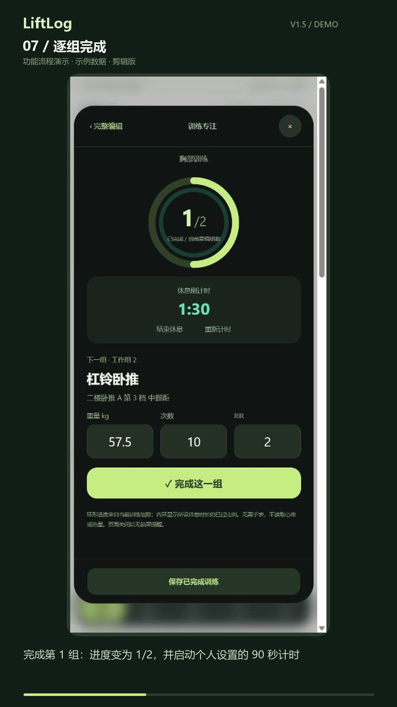
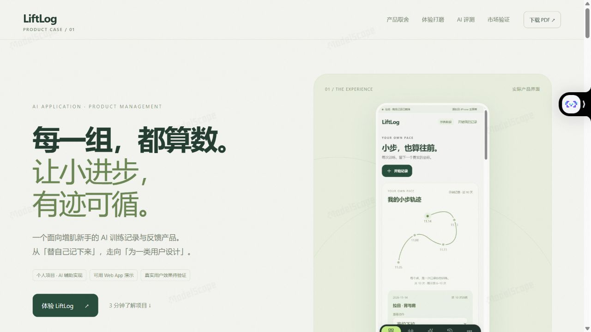
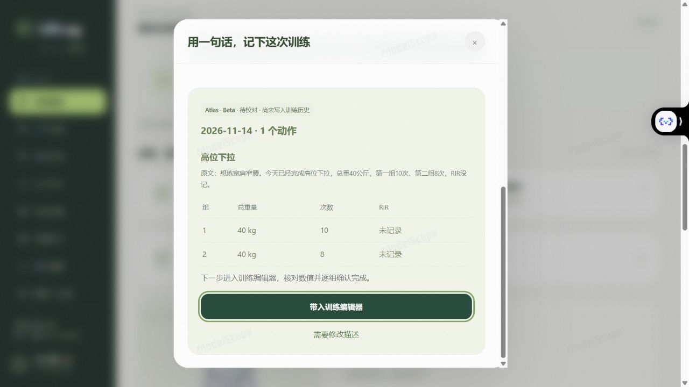
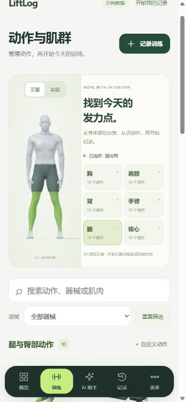
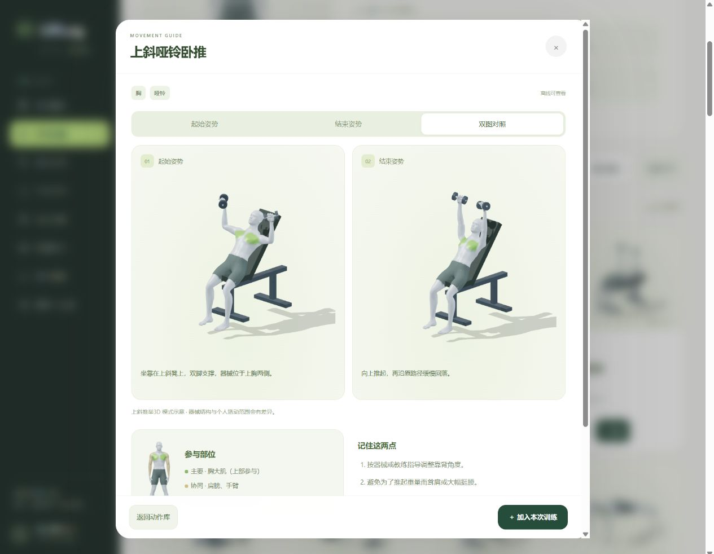

# LiftLog · iPhone 主屏幕训练日志

[大陆体验（魔搭）](https://modelscope.cn/studios/VermouthLau/liftlog?mode=full) · [Vercel 历史版本](https://liftlog-pwa.vercel.app/) · [功能流程视频（V1.5，89 秒）](docs/demo.mp4)

<a href="docs/demo.mp4"></a>

视频使用本机示例空间录制，含中文步骤字幕，无旁白；为真实界面采样录屏的剪辑版。本次演示未调用真实模型，不代表真实训练或用户效果。

当前集成版本：V1.15.2 · LiftLog Atlas 1.7B Run02。四个文字AI功能统一使用本地LoRA微调后的Qwen3-1.7B，合并并转换为Q8_0 GGUF，在魔搭免费CPU容器推理；不回退DeepSeek。语音使用设备/输入法听写，Atlas只处理核对后的文字。原魔搭链接已完成切换，[22项公网验收](docs/atlas17-live.json)通过；四个文字任务示例实际耗时约4–24秒。线上使用完整GGUF，分片方案仅本地候选；Vercel链接是历史版本。

143项检查通过，断网2核8GB实际容器验收22项通过。[部署来源与复现](training/atlas-1.7b/deployment/README.md) · [容器记录](docs/atlas17-container.json) · [40问与16跨任务回归](evaluation/atlas17-deployment) · [作品集部署说明](dist/portfolio/atlas-deployment.html)。56条全部完整返回；严格内容AI复核21/40→20/40，2题改善3题退步；跨任务14/16。属于已见合成题回归，不代表真实用户准确率。

V1.15.2 轨迹更新：曲线展开、光点沿路径移动、节点呼吸与本段回放，支持减少动态效果。[变更说明与动效预览](docs/trail-v1.15.2/README.md)。

V1.15.1 界面精简：减少重复说明，知识资料按需展开，手机复盘优先呈现操作。143 项功能检查与 32 项多尺寸页面检查通过；[界面变更与截图](docs/ui-v1.15.1/README.md)。

项目定位：面向健身市场需求的个人探索作品，用于 AI 产品经理校招／实习作品集，不以正式商业运营为目标。当前重点是产品体验、健身 RAG、模型评测与可复核的迭代过程；招募用户、专业人士审核和收费均不是本次交付条件。市场需求与增长设想作为待验证假设呈现，合成测试不代表真实用户效果。

## 已确定的小模型训练方向

用户于2026-11-14明确选择独立训练的小模型，固定为 **LiftLog Atlas，官方Qwen3-1.7B底模＋本地LoRA微调**。[训练方案与复现](training/atlas-1.7b/README.md) · [单独保存的100道知识验收题](evaluation/fitness-100/PROTOCOL.md)。61张带来源知识卡作为RAG资料；977条训练、131条验证用于学习输出结构、资料使用和任务边界，100道题不参与权重更新或检查点选择。旧0.6B权重保留为历史实验，不冒称可用于1.7B。

当前Atlas部署详见上方V1.15证据。下方数字是Run01历史训练快照，后续Run02与量化部署回归另行报告。DeepSeek API不是我们训练的权重，不再将API提示词优化称为独立模型训练。

本轮已实际完成3轮，选择第2轮checkpoint246；验证损失依次0.1822、0.1718、0.1796。已导出可直接离线加载的完整BF16模型，并用该导出模型完成100题。以下为固定资料、固定提示、非思考贪心解码下的合成题结果，不代表通用健身知识准确率或真实用户效果：

| 口径 | 原始Qwen3-1.7B | Atlas |
| --- | ---: | ---: |
| JSON／结构有效 | 70/100 | 100/100 |
| 引用与数值程序检查 | 67/100 | 99/100 |
| 严格内容通过（非盲AI复核） | 4/100 | 51/100 |
| 内容＋程序校验的端到端 | 2/100 | 51/100 |

另16条跨任务回归通过12条，暴露未来计划误录、缺次数、无效记录优先与冲突澄清问题。本地模型与失败结果已保存，尚不直接替换线上；后续沿用Atlas1.7B补齐负例、澄清与多证据回答，而不是更换模型或仅追加轮数。[逐题结果](evaluation/fitness-100) · [运行记录](training/atlas-1.7b/results/summary.json) · [案例报告](dist/portfolio/fitness-rag.html)。专业审核与真实用户招募不是该个人实验的交付门槛。

## 历史单主模型（V1.13 DeepSeek，现已替换）

[选型决策与迁移边界](docs/single-model-v1.13.md)。记录整理、资料问答、时间规划与复盘统一调用DeepSeek，同一服务端模型配置，默认deepseek-flash。前台不再选择模型；语音用DeepSeek配套ASR工具，RAG仍为本机资料检索。Atlas训练数据、权重与历史评测保留为实验档案，生产不再启动本地模型，也不再安装Python/深度学习依赖。

旧Atlas请求明确返回410，不把原本只同意Atlas处理的内容自动转发给DeepSeek。AI需要联网，手动记录仍可离线。以下Atlas与双模型资料为历史实验快照，不代表现行架构。

## 资料问答与语音录入（V1.12）

[模型同题对照案例](dist/portfolio/knowledge-evaluation.html) · [冻结题目与完整结果](evaluation/knowledge) · [功能设计与边界](docs/knowledge-design-v1.12.md)

12条原创资料摘要保留官方/研究来源，中文切词、BM25与主题检索，不引入Embedding费用。相同问题、资料与Prompt下，Atlas Run07的8题均结构失败；DeepSeek flash的8题结构有效，7题通过严格AI语义复核，1题有过度绝对化表述。全部题目为AI合成、未独立人工审核，非真实用户准确率。8次API用量2395输入/769输出token，按峰时未命中缓存保守估算约0.00164美元，非实际账单。3项免调用策略控制不计模型能力；两种服务的硬件和JSON约束不同。

因此Atlas继续训练记录提取，暂不开放问答；DeepSeek问答需要单独选择和同意，不发送训练历史。语音采用本机录音/文件预览、确认上传DeepSeek ASR、核对文字、填入描述，不自动保存。当前60秒以内，服务端再次校验WAV，音频不落盘。手机浏览器权限与嵌入策略仍需真机验收。

Run10主体语境微调未过门槛，不替换Run07；保留失败结果，避免用轮数代替任务进步。详见 [训练实验记录](training/atlas/README.md#run10主体与上下文实验未晋级)。

## 产品体验与求职案例（V1.11）

[浏览中文项目案例](https://vermouthlau-liftlog.ms.show/portfolio/index.html) · [6 页 PDF 投递版](dist/portfolio/LiftLog-AI-PM-CaseStudy.pdf) · [体验迭代说明](docs/product-polish-v1.11.md)

本次重点是面向使用者打磨完整流程：复盘无记录时提供清楚的记录入口，有较早记录时可扩展到 28 天；隐藏主流程中的内部编号、JSON 与毫秒耗时；默认选择可用的 Atlas，切换识别服务重新确认授权，失败保留输入并提供手动记录入口。设置里增加案例入口和版本说明。

作品集呈现用户假设、产品取舍、AI 方案、失败分析、真实评测口径与拟开展的市场验证。个人项目，编码与合成数据由 AI 辅助实现；尚无用户访谈、留存、收入或付费转化结论。原始模型 44/48 与含程序校验的完整流程 48/48 分开呈现，不把系统成绩称为模型准确率。

122 项自动化检查及语法检查通过；本机验证 Atlas 草稿、逐组确认、保存、刷新与 28 天回看，320px/390px 手机布局检查通过。公开版本 V1.11.0、App/案例/PDF 资源哈希与本地一致，Atlas 已就绪；浏览器验证了旧缓存升级、复盘空态和 Atlas 默认入口。没有付费 API 验收调用。未替代 iPhone 真机测试。见 [公开接口验收](docs/v1.11-live-http.json)。

旧窗口更新：结束训练后，关闭所有 LiftLog 窗口，再重新打开；无需清除浏览器数据。



## Atlas 训练记录理解（V1.10）

后续实验：Run08整理40个增肌主题词、增加240条语境样本，最多10轮、实际3轮早停并保留第1轮。旧48条原始结果44→46，但新36条完整流程35→34，未过门槛，**魔搭继续使用Run07**。视频字幕未获取，资料读取状态与失败结论均保留。见 [训练记录与对照](training/atlas/README.md#run08增肌语境与早停实验未发布)。

「一句话记训练」可选择 LiftLog Atlas Beta，将已完成的中文训练描述整理为待校对草稿。基于 Qwen3-0.6B 的 LoRA 微调，服务在容器 CPU 上推理，校验权重哈希，不自动转用付费模型。用户校对、逐组确认后才保存；原有手动记录与 DeepSeek 保留。目标、体脂、肌群和营养词仅作为语境，不据此推断训练组或提供处方。

本地追加2 epochs并保留两份检查点，随后针对132个候选词进行语境适配。新48条合成CPU验收：原始模型44/48，完整流程48/48、错误放行0、P95约5秒；另40条开发回归完整流程通过。规则分流、字段检查与模型成绩分开记录。全部标签为AI合成，尚未经独立审核，不代表真实用户准确率。实验过程、失败记录及数据口径见 [Atlas 模型说明](training/atlas/README.md) 和其 results 目录。

已发布至原魔搭空间。公开接口检查V1.10.0、模型权重哈希与本地一致，合成示例调用约6.2秒；公开页面生成草稿通过。本地完整流程验证了带入编辑器、逐组确认、保存与刷新恢复，390px布局通过；未替代iPhone真机验收。见 [线上验收记录](training/atlas/results/model07.live.verification.json)。本轮付费API调用0。若旧窗口显示V1.9，请结束训练后关闭所有LiftLog窗口再打开，保留原本地记录。



## 结构化模型输出修复（V1.9.1）

快捷录入、取舍建议与复盘重点选择显式使用 DeepSeek 非思考模式，避免默认思考与较小结构化输出预算冲突。保留 JSON 对象格式约束与现有业务校验。分别识别空白、截断、无效 JSON、错误完成原因和无效外层响应；失败不会自动重试或冒充成功，仍可查看本地复盘。新增日志仅记录错误类别、完成原因及内容长度，不记录输入、模型原文、推理内容或密钥。

新增 6 项适配器回归检查；现有快捷录入错误断言改为校验稳定的错误码。真实服务验证与发布记录另见本次验收报告。

## 首页小步轨迹（V1.9）

- 首页直接读取当前浏览器、当前空间近 90 天已保存的有效工作组记录，每场训练生成一个节点；草稿、热身、未来日期和无效记录不会生成节点。一次展示最多 5 个节点，通过上一次 / 下一次回看完整范围。
- 点选日期或切换动作，可查看当次工作组、负重容量与原始记录。曲线弯折及节点距离用于浏览，不代表力量、恢复评分、增肌效果或等比例日期间隔。
- 复用现有条件匹配逻辑，选择最近的设置一致记录，固定展示首个匹配工作组，并披露其他匹配组的混合变化、缺失 RIR、同日多场歧义与未记录器械。持平和下降如实呈现，不挑最弱基线。
- 空个人空间显示明确起点；保存新训练后自动生成节点，刷新后从原有本地存储恢复。页面没有新增模型请求、遥测上传、账号、支付或订阅；示例数据与个人数据继续隔离。

验证：92 项自动化检查通过，包含 8 项轨迹数据边界检查；本地浏览器验证空空间、表单保存、节点生成、刷新保留、日期切换、动作切换与来源记录。发布验收与手机截图记录另见本次部署报告。

## 立体图示重做（V1.8）

- 用同一套带骨骼的人体网格重做所有图示：银灰材质、绿色主要部位与浅金协同部位。正背面点选区域来自实际模型投影，保留文字按钮与键盘入口。
- 60 个动作共 120 张起止渲染图，另有 27 张部位图；杠铃、哑铃、训练凳与器械几何随姿态渲染。手机双图纵向排列，单阶段可单独放大查看，桌面横向对照。
- 全部 WebP 资源约 2.2 MB，首次离线准备完成后可离线查看。用户端不加载 Three.js，也不要求 WebGL；静态 3D 渲染图尚不支持实时旋转或动作识别。
- 人体网格、骨骼与形变来自 MakeHuman Community 的 CC0 数据，Three.js r180 为 MIT。许可证与可复现的渲染工作室见 [artwork/MODEL-NOTICE.txt](artwork/MODEL-NOTICE.txt)；在项目根目录运行 `node artwork/server.mjs`，打开控制台中的工作室地址，可审阅与重新导出所有图。
- 当前肌群高亮是区域近似，不是解剖分割、肌肉激活或恢复评分。姿态与器械是通用模式示意，仍待独立健身教练逐项审核。

84 项自动化检查及全部语法检查通过，覆盖每个动作实际图像、起止差异、部位组合和离线资源存在性，以及原有训练与 AI 接口逻辑。使用示例空间验收手机/桌面的点选、对照与加入训练；真机 iPhone / 微信与实际离线安装仍待验收。本轮未调用付费模型。




## 可视化动作库（V1.7 历史说明）

- 内置动作从 19 个扩展到 **60 个**，胸、肩、背、手臂、腿与核心各 10 个。包含杠铃、哑铃、器械、绳索与自重动作；新增自重动作只记录次数，没有加入需要另一种记录单位的计时动作。
- 首页与训练页提供原创的正面/背面人体区域图。可直接点选区域，或使用相同功能的文字按钮与键盘 Enter/Space，筛选对应动作。高亮表示所选训练部位，不是疲劳、恢复或肌肉激活程度。
- 训练页更新为带姿势缩略图的动作卡片。动作名、肌群与器械可搜索，支持器械与部位组合筛选；无结果时提供清除筛选与自定义入口。
- 动作详情包含 **起始姿势 / 结束姿势 / 并排对照** 三种视图、主要与协同参与部位、两条要点、记录口径与资料入口。60 个动作映射到 33 类动作模式，以原创绘制的二维 SVG 示意呈现，不是真人示范视频、个体化动作教学、摄像头姿态识别或专业动作评分。
- 查看后可直接加入当前训练，编辑器中也保留「姿势图」入口。新动作不会自动完成、加重或改写已有草稿的动作。图与说明全部随应用壳缓存，首次离线准备完成后可离线查看；外部资料链接仍需要网络。
- 保留全部旧动作名称。与新增内置动作重名的旧自定义动作优先使用原分组、备注与记录方式，完整备份也可恢复；已删除的同名自定义动作不会被内置库重新启用。自定义动作只展示区域与用户备注，不借用内置姿势图。单臂哑铃划船注明单侧重量，原双侧总重量口径与历史记录保持一致。

动作说明参考 [ACE 动作库](https://www.acefitness.org/resources/everyone/exercise-library/) 与 [Mayo Clinic 力量训练教学](https://www.mayoclinic.org/healthy-lifestyle/fitness/in-depth/strength-training/art-20046031) 的通用原则，以原创简短文字与示意图表达。器械结构与个人活动范围会有差异，当前内容尚未经独立健身教练逐项审核。

**82 项自动化检查与全部语法检查通过**，覆盖目录完整性、搜索组合、自重口径、同名自定义动作迁移、旧模板恢复、自然语言录入目录兼容、图形坐标与输出转义。浏览器使用示例空间验收了肌群选择、正背面切换、搜索/器械筛选、无结果恢复、姿势阶段切换、加入当前训练、自重无重量输入与训练内姿势入口；检查 320px、390px 与桌面布局。没有进行真实模型调用或真实用户效果验证，真机 iPhone / 微信入口与首次离线安装仍待验收。

## 训练流程迭代（V1.6）

- **我的训练模板**：在训练编辑器或历史详情点「存为模板」，也可以从练后总结保存。首页和训练页可直接启动。最多 20 个，保留动作顺序、组类型、组数、器械快照及参考重量/次数；新训练使用新 ID 和今天日期，完成标记、RIR、状态、时长与 AI 来源关联不复制。模板中的数值仍需用户按实际训练确认。删除模板可在提示中撤销。
- **上次记录参考**：完整编辑与专注模式展示同动作、同记录方式、严格更早日期的最近有效记录。可将对应组的参考重量/次数填入未完成组，不修改完成组、RIR 或本次器械设置。它不是条件匹配的进步判断，也不推荐加重。无对应组时保留当前输入。
- **倒计时恢复**：休息的截止时间和设定秒数随草稿保存。关闭编辑器、刷新或重开页面后，继续训练按原截止时间恢复；过期不重启。仍无锁屏通知，不会在后台保证声音提醒，离线壳首次准备仍需联网。
- **练后总结**：完成保存后展示实际完成动作、工作组、负重容量、自重次数与用户填写时长，排除未完成组。可查看记录或保存模板；历史修改不弹出新训练总结。首页解释示例/个人空间和第一场训练的步骤。
- **可继续或移除草稿**：启动模板不会覆盖现有草稿。完整编辑器可移除草稿，并在提示中撤销。模板随完整 JSON 备份恢复，旧版本备份仍可导入。备份恢复仍不恢复进行中的草稿。
- 修复专注模式修改数字时访问不存在的完整编辑按钮导致报错的问题。新增动作带入历史数值时，不再复制过去的实际 RIR。

本轮新增功能均在本机运行，不增加模型调用。74 项自动化检查和全部语法检查通过，不代表模型准确率或真实用户效果。演示与界面验收使用示例空间；iPhone Safari 安装、微信入口与真机后台行为仍需另行验收。

## 新增训练功能（V1.5）

首页「这次，有没有真正进步？」或「AI 助手 → 进步与状态」进入训练洞察。「更多」也保留入口。这三个新分析功能在本机运行，不需要模型调用，也不会将睡眠、疲劳或器械设置发送给 DeepSeek。

- **表现对比**：匹配已记录的动作名称、动作顺序、器械设置（含所设计时）、工作组序和已知且相同的 RIR。同重量比次数、同次数比重量；其余情况不强行排名。基线为设置一致的最近更早日期，跳过更近但条件不同的记录会披露。最新日期有多场同动作记录时不猜顺序；热身、不完整或无效输入、未来日期不纳入。多组有升有降显示混合结论，不能把单组差值写成整场或生理效果。
- **器械卡**：记录器械标识、座椅档位、握法和个人休息计时。新加入动作时保存当次设置快照，后续修改卡片不回填历史。训练内可单独修改。未完成动作可以手动替换为同部位的另一个可用动作，数值清空；已有完成组则需保留原动作并另行添加。同部位不表示等效或适合每个人。
- **个人状态观察**：训练编辑器中可选填前一晚睡眠时长、训练前疲劳感 1–5。保存自选观察问题、因素和分组界线；按同设置、同动作顺序、同重量与 RIR 的首个有效工作组比较次数。每侧至少 3 个不同日期才展示均值差，这是展示门槛，不代表统计显著。缺失状态、条件不同与同日重复条目排除并计数，不补造数据。分组界线不是健康标准，均值差是观察性关联，不说明因果，不形成恢复评分或训练处方。
- **训练专注模式**：进入训练编辑器后点「专注模式」。采用类似运动手表的深色大字界面：外环为当前训练草稿已完成组 / 总组数，内环为所设休息时间的已过比例。用户逐组确认后推进到下一组，并按本次器械设置启动计时；可结束或重新计时、返回完整编辑。可保存实际已完成训练，未完成组不写入历史。调整草稿组数会改变分母。

这是手机网页上的手表风格交互，不是 watchOS App；没有 Apple Watch、HealthKit、心率或热量接入。倒计时按时间戳更新，页面在后台后回到前台可核对剩余时间；不提供锁屏通知，V1.6 起，关闭后继续草稿可按原截止时间恢复倒计时。训练草稿仍自动保存。

旧记录未包含器械设置或状态时保持未知：未记器械的比较会直接提示无法确认相同器械，无法匹配的记录会等待更多数据。休息设置只代表预设，不代表实际休息；动作幅度、节奏、体重、主观 RIR 误差等仍未控制。自重仅比较次数，不推断体重或外加负重。

本轮共 66 项自动化测试及全部语法检查通过。浏览器中已使用示例空间验证器械卡保存与 90 秒计时带入、睡眠／疲劳录入、临时替换清空数值、专注模式逐组推进和实际训练保存；检查 390px 手机宽度与桌面布局、320px 器械卡无横向溢出。仍需真机 Safari、微信入口和后台计时行为验收。

器械卡、观察主题、历史中的状态和设置快照均纳入完整 JSON 备份恢复。用户更改或删除历史后，分析重新计算。当前功能检验使用合成测试与本机示例数据，不代表真实用户效果或模型效果。

### 差异化与作品集验证

对公开官方资料的有限检查显示，[Hevy 已支持按动作或同计划查看上次训练值](https://www.hevyapp.com/features/track-exercises/)，[Fitbod 已提供依据日志变化的自适应训练](https://help.fitbod.me/hc/en-us/articles/43492523917207-How-does-Fitbod-adapt-as-I-get-stronger)。不把这些能力或本项目的新组合宣称为市场首创。本轮产品假设是：可追溯、披露缺失条件的比较，结合器械快照和低负担状态记录，能够减少用户误读训练变化。

建议真实体验任务：相同动作在不同器械或不同 RIR 条件下，用户是否能解释为什么未比较；被占用器械的替换是否出现错用原重量；专注模式逐组完成是否减少查找动作和计时操作。记录任务耗时、误操作、放弃与解释正确率，控制任务难度和顺序；样本与阈值应预先约定，勿把示例演示或单次好评当成效果证据。

手机底部导航为「概览／训练／AI 助手／记录／更多」；AI 助手内可切换训练取舍与训练复盘，进步趋势和数据设置在「更多」。桌面保留侧边导航。动作限制和时间估算可展开查看，动作限制标题显示当前必留与暂不做的数量，修改时保持展开状态。

界面已在本机浏览器 390px 手机宽度与 1440px 桌面宽度下检查，并验证 320px 取舍页无横向溢出；用示例数据完成取舍、草稿、勾选与实际保存。53 项回归测试及语法检查通过。此检查不等同于真机 Safari 验收。

在原 LiftLog 基础上增加的 PWA 版本。无需苹果开发者账号；正式 HTTPS 地址可在 iPhone Safari 中「分享 → 添加到主屏幕」。底层使用 Web 技术，独立窗口运行，不是 App Store 原生安装包。

## 已实现

- 原有训练记录、重量/次数/RIR、自定义动作、自重动作、休息计时、草稿、历史、趋势与 PR。
- 主屏幕图标、独立窗口、iPhone 安全区域和底部导航适配。
- Service Worker 预缓存应用壳。首次联网准备完成后，可离线打开、记录训练、查看历史及本地复盘。
- 7 / 28 天复盘，与上一同长周期比较；可切换记录习惯、训练变化、记录质量三个关注点。
- 展示日志依据并跳转原始训练；本地规则与可选模型结果清晰区分。
- 用户反馈、生成耗时、失败记录和 JSON 评测导出。仅保留当前空间最近 200 次复盘尝试。
- JSON 备份导出与恢复，支持原版 LiftLog 的版本 1 备份。恢复需预览并确认替换个人空间；示例空间保持独立。

## 在电脑运行

需要 Node.js 20 或更新版本，无需安装依赖。

```powershell
node server.mjs
```

打开 http://127.0.0.1:5173 。电脑 localhost 仅供本机开发，不能作为 iPhone 安装地址。

## 在 iPhone 使用

1. 在 Safari 打开已部署的 HTTPS 地址；私有发布时，使用有权限的账户登录。
2. 等待顶部显示「离线记录已就绪」。
3. 点分享 → 添加到主屏幕；若出现「作为网页 App 打开」，保持开启。
4. 从主屏幕图标重新打开，先确认当前空间和记录。Safari 与主屏幕应用的存储可能独立。
5. 需要迁移时，在旧版本导出 JSON，再到新版本「数据与设置 → 选择 JSON 备份」恢复。
6. 初次准备完成后可尝试飞行模式；AI 模型复盘始终需要联网。

数据只保存在当前设备/浏览器/站点地址下，不跨设备同步。清除站点数据、系统回收存储或更换域名可能导致记录不可用，请定期导出备份。休息计时只在打开的页面内展示，不是锁屏通知。

## AI 功能的真实边界

默认运行的是**本地规则复盘**，不调用模型，不代表已完成模型效果验证。

可选的 DeepSeek 服务端接口已经实现：模型根据用户关注点，从程序计算好的事实和候选下一步中选择重点。模型输出只允许有效编号，所有展示数字仍来自日志；模型不能自由编造训练结论或修改训练负重。

当前正式站点为 https://liftlog-pwa.vercel.app/ 。Vercel 部署包含静态 PWA 和 `/api/ai/` 服务端接口；只有服务端配置 `DEEPSEEK_API_KEY` 后才会启用真实模型，未配置时继续提供手动记录和本地规则复盘。

本机验证真实模型时：复制 `.env.example` 为 `.env`，自行填入密钥，然后运行：

```powershell
node --env-file=.env server.mjs
```

在「智能复盘」中查看将发送的汇总依据，勾选同意后点击「生成 AI 复盘」。仅发送当前周期统计文字和关注点，不发送体重、训练名称或逐组训练记录。密钥始终保留在服务端，不放入前端、Git 或浏览器存储。

接口参考：[DeepSeek JSON 输出官方说明](https://api-docs.deepseek.com/guides/json_mode/)。请求超时、格式不合法或未知引用均显示失败并保留本地复盘。当前 Node 服务仅用于本机开发。Vercel 接口校验同源请求、JSON 类型和请求体大小，并提供单实例的每 IP 每小时 20 次与 3 个并发请求的体验限制。该限制不是全局费用上限；公开运营还需在服务商设置额度，或接入共享计数与认证。

## 验证

```powershell
node --test tests/*.test.mjs
node --check dist/app.js
node --check dist/review-ui.js
node --check dist/review.js
node --check dist/pwa.js
node --check dist/backup.js
node --check dist/sw.js
node --check ai.mjs
node --check server.mjs
```

当前 53 项自动化检查通过，覆盖原有数据统计、自重动作、动作删除恢复、周期边界、未知 RIR、备份恢复、模型输出校验、模拟模型成功/失败、预缓存资源、离线缓存处理和更新范围。模型调用使用模拟响应验证，未进行真实付费调用。Service Worker 自动化检查使用受控缓存环境；真机 Safari 安装与飞行模式仍需 iPhone 验收。

## 用于 AI 产品经理作品集

产品假设：已经记录训练的人，需要快速看懂最近的记录并发现信息缺口。尚未通过真实用户研究验证。

可以演示「记录 → 数据依据 → 复盘重点 → 回看来源 → 反馈」完整流程。不要把示例空间数据、自己的演示评价或自动化测试通过率写成真实用户增长或模型准确率。

建议下一轮招募 5–10 位训练者体验：记录录入耗时、复盘来源是否可理解、反馈是否有帮助；独立比较本地规则与模型选择。预先约定指标和失败标准，再决定模型调用是否值得其等待时间和成本。

## 发布与源文件

`.openai/hosting.json` 保存 Sites 项目标识及静态目录。`dist/` 是前端源文件与静态发布产物，`api/ai/` 是 Vercel Functions 入口，`lib/` 保存服务端逻辑；本项目没有前端构建步骤。`vercel.json` 指定静态目录和函数超时。修改应用壳后需同步修改 `dist/sw.js` 中缓存版本。新版本不会强制中断当前训练；关闭所有旧窗口再打开后生效。

原项目保留在原目录，本目录为独立升级副本。未授予开源许可证。


## 本轮 AI 产品优化：自然语言录入（V1.2）

### 产品决策

优先解决训练后反复填写重量、次数、组数的录入成本。目标用户先收窄为已经知道动作名称、愿意记录实际完成组的力量训练者；该目标和需求强度仍需用户访谈验证。

选择「描述 → 结构化草稿 → 人工校对 → 保存」，让模型负责语言理解，程序负责字段校验，用户决定最终记录。不会根据模糊描述生成训练处方，也不把未来计划计作已完成训练。这一阶段不需要为了展示技术而增加 RAG、多智能体或自动改负重。

### 已实现的工作流

- 首页「一句话记训练」支持手打或系统输入法语音转文字；没有新增录音上传或麦克风权限。
- 用户同意后，仅发送本次文字与可用动作名称、记录方式到 DeepSeek；不发送训练历史或体重。
- 模型输出动作、逐组重量/次数/RIR、热身标记、日期和对应原文，或输出需要补充的信息。
- 程序拒绝库外动作、伪造引用、未来日期、无效数值与过多训练组。缺失 RIR 为未知，0 为明确的 RIR0。
- 结果不会直接写入历史；带入编辑器后，用户核对并逐组勾选，点击完成训练才保存。
- 有同日草稿时追加组，不覆盖；不同日期草稿要求先处理，避免把两天训练混在一起。
- 模型失败、未配置或离线时，明确提示并保留手动记录。

### 观测与评测

`intakeRuns` 只在当前空间本机保存，最多 200 次。记录请求结果、模型/提示词版本、响应耗时、API 返回的输入/输出 token 数、带入/保存状态，以及保存时的字段修改和删除组数；默认不保存原始输入文字到评测日志。

「数据与设置」提供录入结果计数、平均响应时间、已保存组的字段修改率和 JSON 导出。它们是体验线索，不能当作准确率或真实增长结果。示例空间必须单列。

`evals/intake-cases.json` 提供 20 个**人工编写的合成样本**及期望结果，覆盖歧义、缺失、单位、日期、组类型、自重、RIR 和注入。尚未运行真实模型时，不报告模型通过率。

```powershell
# 只检查样本清单，不调用模型
node scripts/evaluate-intake.mjs

# 配置本地 .env 后显式执行真实模型评测，会产生 DeepSeek 用量
node --env-file=.env scripts/evaluate-intake.mjs --live
```

下一步实验：让同一批体验者交替完成手动录入与 AI 录入的同类任务，记录总耗时、操作数、错误和放弃原因；控制任务难度和顺序，单独保留失败案例。预先约定验收门槛，按「模型理解／动作映射／字段校验／网络／交互」归因，不能只挑成功演示。

### 线上配置

在 Vercel 项目 `liftlog-pwa` 的 Settings → Environment Variables 添加：

- `DEEPSEEK_API_KEY`：你自己的密钥，只选需要的环境并设为敏感值，绝不提交 Git。
- `DEEPSEEK_MODEL`：可选，默认 `deepseek-flash`；以 DeepSeek 账号可调用的模型为准。

新增或修改环境变量后需要重新部署。项目源码不需要密钥，前端也不会接收密钥。模型调用使用真实 DeepSeek API；自动化测试的模拟响应仅用于接口校验，不作为产品默认结果或模型效果证据。

## 本轮差异化探索：训练取舍实验室（V1.3）

### 有边界的竞品结论

2026-11-13 对三个产品的公开官方资料做了小范围比较：[Fitbod 个性化与时间配置](https://fitbod.me/faqs/)、[Fitbod 训练定制说明](https://help.fitbod.me/hc/en-us/sections/31812780318743-Exercise-Workout-Customization)、[Hevy 记录与分析功能](https://www.hevyapp.com/features/)、[RP 根据反馈调整重量、次数和组数](https://hypertrophy.zendesk.com/hc/en-us/articles/14605661323671-How-Does-the-App-Determine-When-to-Add-Weight-Reps-and-Sets)。自动排训练、按时间调整、记录与反馈都已有成熟产品。本项目不声称全球首创，也不能根据公开页面未提及就认定竞品没有某项能力。

这轮要验证的差异化假设是：当时间或设备受限时，用户希望看清多个方案分别牺牲了什么，自己做选择，并在练后核对这项选择是否兑现。产品闭环为「限制 → 对比 → 显式选择 → 决策回执 → 实际核对 → 可撤回的偏好记忆」。该组合的需求强度和竞争优势仍未验证。

### 现在可以演示的功能

首页点「比较我的取舍」，或进入「取舍实验」。个人空间需要先有一场包含已完成工作组的训练；示例空间可直接体验。

1. 选择参考训练、时间预算、优先动作，指定必留动作（至少一个工作组）及今天暂不做的动作。
2. 比较「多保留动作」「主项优先」「减少动作切换」。卡片展示工作组、动作种类、动作切换次数以及逐动作删减。相同结果去重；无解会要求用户调整条件，不偷偷放宽限制。
3. 可选输入偏好，让 DeepSeek 从已验证可行的卡片中选择，或追问一个问题。仅在用户勾选同意后发送偏好、方案统计和主动记住的最近三次取舍；不发送重量、逐组记录或完整训练历史。
4. 选择方案生成决策回执和未完成草稿。原有训练不变，用户核对数值并勾选实际完成组后才写入历史。已有非空草稿时先处理草稿。
5. 保存后核对记录时长是否超预算、必留动作是否有完成工作组、计划组数完成情况。未填时长不算按时成功；修改或删除实际训练后重算结果，选择时的快照保留。
6. 用户主动决定是否记住这次取舍，可随时取消参考，并反馈有帮助／不合适。回执支持导出，完整备份包含回执及结果关联。

时间估算来自可编辑的准备时间、每组含间隔时间和动作切换时间。它是排程假设，不是推荐休息时长或完成时间承诺；动作切换次数不等于器械切换次数。规则仅裁剪已完成来源记录的工作组，并保留入选动作原有的已记录热身组；不增加原组数、重量或次数，也不评估生理效果。带入前后的数值都由用户核对。

### 为什么这样划分 AI 与程序的职责

硬限制、时间计算、方案可行性与结果核对由可测试的程序处理；模型负责理解自然语言中的偏好冲突和给出澄清，不能凭空造计划、改写训练事实或直接执行决定。用户最终选择可以与 AI 不同。模型不可用时，离线比较和手动选择仍可使用。

### 如何验证产品价值

先招募 5–10 位已有记录习惯的训练者，比较「直接缩短训练」与「看完取舍卡片后选择」的同类受限任务，交替任务顺序。记录选择耗时、理解错误、放弃原因、实际是否完成及主观帮助。独立对比规则卡片与 AI 协助，判断模型是否减少纠结，及其额外等待是否值得。

建议先约定验收门槛再测试，例如至少 80% 参与者能正确解释所选方案删去了什么；这是待验证门槛，绝不是现有结果。按时完成率的分母仅包含已有实际时长的关联训练，同时报告缺失时长比例；计划组数以同动作的有效已完成工作组匹配并封顶，额外无关动作不抬高完成率。样本和反馈存在选择偏差，不能以关联关系推断方案导致了结果，也不能把完成组数等同于增肌效果。

`decisionReceipts` 最多保留当前空间最近 100 张回执，`labRuns` 最多保留 100 次成功返回的模型比较元数据（提示词版本、耗时、用量等），不保存原始偏好到用量日志；偏好文字会作为用户选择快照保存在本机回执中。当前失败比较显示错误但不计入 `labRuns`，因此不能用它计算全请求成功率。后续线上实验应补齐含失败分母的观测并记录用户授权范围。

### 当前证据与未验证项

53 项自动化检查通过，新增覆盖数百种预算与限制组合、不可行方案、热身与自重、来源变化、草稿保护、未知时长、后续修改、备份恢复、显式记忆、模型摘要最小化与非法方案拒绝。手机宽度界面已走通「选择 → 未完成草稿 → 实际保存 → 补填时长 → 反馈 → 取消记忆」。全部使用本机示例数据。

模型接口测试使用模拟响应；生产环境的 DeepSeek 配置状态可以确认，但本轮尚未完成新增取舍接口的真实模型调用验证，不报告模型准确率。真机 iPhone 的安装、离线与微信入口仍应分别验收。生产更新不会强制中断正在训练的旧窗口；关闭所有旧窗口再打开以加载新版。

