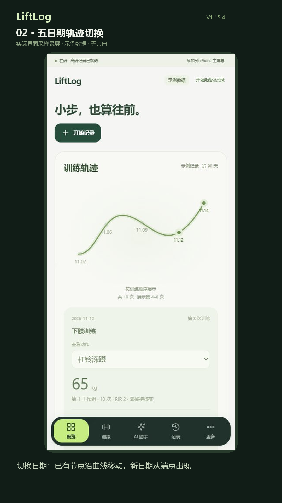

# LiftLog V1.15.4 · 完整功能演示

[播放／下载 MP4](LiftLog-v1.15.4-demo.mp4) · [下载演示资料包](../releases/LiftLog-v1.15.4-demo-kit.zip) · [公开体验](https://modelscope.cn/studios/VermouthLau/liftlog?mode=full) · [项目源码](https://github.com/liumuyuan36/LiftLog)

视频约 **03:46**，1080 × 1920，12 FPS，H.264 MP4，含中文步骤说明，无旁白。它是隔离浏览器中的真实界面采样录屏剪辑，全部使用内置示例与本次创建的演示数据。首页与轨迹补录一遍以保持曲线完整可见；后续章节保留原完整操作过程及模型等待，没有用预设答案冒充模型返回。另附 [SRT 字幕](subtitles.srt)和[机器可读章节](chapters.json)。

## 按时间体验

| 时间 | 功能 | 操作与边界 |
| --- | --- | --- |
| 00:00 | LiftLog 完整体验 | 示例数据 · 实际界面录制 · Atlas 真实本地推理 |
| 00:05 | 五日期轨迹切换 | 切换日期：已有节点沿曲线移动，新日期从端点出现 |
| 00:13 | 肌群与动作可视化 | 按身体部位找动作；姿势图支持起始、结束与双图对照 |
| 00:27 | 自定义动作 | 支持自己的器械与记录方式；不冒用内置动作姿势图 |
| 00:34 | 一句话记训练 | 手机可用输入法听写；这里演示核对文字，不模拟语音识别 |
| 00:40 | Atlas 整理草稿 | 先同意发送描述，再真实调用模型；生成结果不会自动保存 |
| 01:15 | 人工核对与训练状态 | 重量和次数仍由你核对；余力、睡眠、疲劳可以自行填写 |
| 01:23 | 专注训练与休息计时 | 完成进度与个人休息计时；不读取手表心率或热量 |
| 01:36 | 保存实际完成的组 | 仅勾选完成的组进入历史；示例手动填写时长为 18 分钟 |
| 01:46 | 模板复用 | 保留动作和参考数值；新训练的完成标记与余力不会自动带入 |
| 01:52 | 历史与进步趋势 | 可回到原始训练核对；容量和 e1RM 均有明确计算口径 |
| 02:06 | 时间有限，比较取舍 | 按已有训练生成可行方案；时间是可修改的估算，不是保证 |
| 02:13 | Atlas 协助选择 | 只在已有可行方案中选择，用户仍可选其他方案 |
| 02:29 | 从真实记录生成复盘 | 统计由日志计算；Atlas 只选择重点，不改写记录或安排训练 |
| 02:42 | 增肌资料问答与引用 | 先在本机检索，再同意由 Atlas 根据资料回答 |
| 03:06 | 表现、器械与状态观察 | 按相近条件比较；器械或样本不足时明确提示 |
| 03:18 | 备份与恢复预览 | 记录保存在当前浏览器；恢复前显示替换范围并等待确认 |
| 03:26 | 添加到 iPhone 主屏幕 | Safari 分享 → 添加到主屏幕；PWA 不通过 App Store 安装 |
| 03:31 | 离线查看记录 | 断网后仍能打开应用、历史与训练记录；AI 功能需要联网 |
| 03:39 | 一个可核对的 AI 产品作品 | 记录 → 核对 → 保存 → 回看；需求与效果仍需真实用户验证 |

## 这次更新了什么

首页轨迹从静态切页改为五日期窗口：向较近的记录推进时，最早节点退出，保留的四个节点沿曲线移动，新日期从末端进入。反向查看可倒退一条记录。点选当前日期只查看对应详情，减少动态效果时直接切换。曲线表示训练顺序，不把曲线高度解释成增肌量或身体变化。[动效预览与检查](../trail-v1.15.4/README.md)。

演示依次完成：筛选肌群、比较动作起止姿势、自定义动作、口语整理草稿、核对重量与次数、填写余力和器械、专注训练与休息计时、保存完成组、创建模板、查看历史与体重、比较时间受限方案、生成复盘、检索问答及来源、器械卡和状态观察、导出备份与恢复预览、查看 iPhone 安装说明、断网后查看历史。恢复预览最后取消，没有替换个人数据；安装章节展示说明，没有冒充 iPhone 真机安装验收。

## AI 实际做了什么

四个入口使用同一个 **LiftLog Atlas 1.7B Run02**：官方 Qwen3-1.7B 底模，经本地 LoRA 监督微调后合并，转换为 Q8_0 GGUF。模型哈希为 665f64068c254f73fccd732b03c6904cfc939ee66998437d77da3e4771545658，与当前魔搭状态一致。本次为 UI 更新，没有重新训练或更换模型。

录制时真实请求本机 2 CPU / 8 GB 容器，使用同一模型产物，不调用 DeepSeek 或其他收费 API。界面服务器与本地模型服务器之间由录制工具转接，未伪造服务端响应。[四次请求与原始返回](capture-evidence.json)仅含示例信息；这是功能演示样本，不是准确率评测，也不是线上延时承诺。

| 入口 | 本次实际等待 | 返回 |
| --- | ---: | --- |
| intake | 28.51 秒 | HTTP 200 |
| decision | 5.43 秒 | HTTP 200 |
| review | 5.25 秒 | HTTP 200 |
| knowledge | 10.86 秒 | HTTP 200 |

- 记录整理：输入“今天杠铃卧推总重42.5kg，两组分别11次和9次”，模型输出两个工作组；未知 RIR 留空，由演示者补充后确认。
- 时间规划：本地规则先生成可行候选，Atlas 按“保留主要动作组数”的偏好选择主项优先；视频随后由演示者手动选择另一方案，展示选择权仍在用户。
- 训练复盘：统计由代码计算，模型从给定事实中选重点，不生成假记录或直接改写训练。
- 增肌问答：应用检索 61 张资料卡，Atlas 根据本次找到的资料回答 RIR2 并引用 F01；检索不是重新训练权重，引用也不等于内容自动正确。

语音入口使用设备／输入法听写，本视频键入文字展示核对流程，没有录制或假装自动语音识别。专注模式的环形进度来自完成组与休息时间，不读取 Apple Watch 心率或热量。

## 作品集呈现

这是面向健身市场需求的个人探索作品，用于 AI 产品经理校招／实习。可展示“记录负担 → 草稿核对 → 完成组保存 → 相近条件下回看 → 检索与来源”的完整产品流程，以及单模型取舍、结构校验、失败保留和用户确认设计。当前没有真实用户增长、留存、商业收入或专家背书；示例进步不代表真实增肌效果。[中文案例页](https://vermouthlau-liftlog.ms.show/portfolio/index.html)保留产品思路，最新体验以本版本视频与部署证据为准。

## 验证与文件

143 项功能检查、32 项多尺寸布局检查、8 项日期切换交互和 21 项公网核对通过。完整录制包含 20 个章节、4 次真实模型调用，无页面脚本异常；末尾验证已保存记录可在离线刷新后查看。MP4 已完整解码检查，字幕与章节按最终剪辑时间生成。[验证汇总](verification.json)。公网资源核对不发送训练数据，四次模型调用另行记录。

资料包包含视频、封面、中文说明、字幕、章节、示例调用证据、轨迹动图、部署与布局核对及第三方素材说明。源码同步在原 GitHub 仓库，模型大权重、密钥、个人记录、浏览器配置和原始采样帧不包含在资料包中。

旧窗口升级：完成当前训练后关闭所有 LiftLog 窗口并重新打开，无需清理浏览器数据。个人记录按浏览器保存在本机，建议在“更多 → 数据与设置”导出备份。
