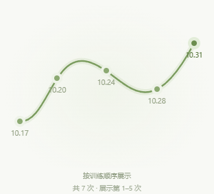

# V1.15.4 · 训练轨迹按日期推进

五个节点组成一个可切换窗口。切到下一次训练时，最早日期退出，四个已有节点沿曲线平移，新日期从末端出现。每次只推进一条记录，约 560 毫秒；反向切换方向相反。点击可见日期只查看详情，不打乱窗口。

预览用专门的合成日期演示 10.17 退出、11.04 进入，然后再进入 11.08；真实首页仍读取当前空间实际保存的训练记录，不写入这套预览数据。轨迹表示训练顺序，位置高低不表示身体增长或退步。

支持快速连续切换、减少动态效果及离开页面时清理动画。没有改动模型权重、知识资料或训练记录。旧窗口请结束训练后关闭所有 LiftLog 窗口再打开，无需清除浏览器数据。

已发布到[原魔搭空间](https://modelscope.cn/studios/VermouthLau/liftlog?mode=full)，源提交 d25b434。143 项功能检查、[32 项多尺寸布局](responsive.json)、[8 项日期切换交互](browser-checks.json)及[21 项公网核对](live-checks.json)通过。公网核对只读取资源和模型状态，不发起推理。

[完整功能视频与说明](../demo-v1.15.4/README.md)
